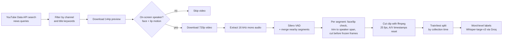

# Vietnamese Audiovisual Speech Dataset Pipeline

A data collection and labeling pipeline that builds a **Vietnamese audiovisual speech recognition (AV-ASR) dataset** from YouTube news broadcasts. It finds news videos, keeps only the segments where an on-screen speaker (news anchor or field reporter) is visibly talking, cuts them into clips with aligned audio and video, and labels each clip with **word-level timestamps**.

> This repository contains the data pipeline only. It does not train an AV-ASR model.

## Pipeline



### 1. Video discovery (`src/yt_download.py`)
- Searches the YouTube Data API v3 with Vietnamese news queries (e.g. storm and flood coverage from VTV).
- Keeps a video only if it comes from a known news channel **and** its title contains a news keyword; music, film, shorts and dubbed content are filtered out.
- Downloads with `yt-dlp` (cookie-based auth, randomized delays): a 144p preview first, then a 720p version only for videos that pass the speaker check.

### 2. Speaker screening (`src/visual.py`)
- **Face detection:** OpenCV DNN face detector (ResNet-10 SSD, Caffe), with a Haar Cascade fallback if the model files are missing.
- **Lip motion:** takes the mouth region of the largest detected face and tracks frame-to-frame pixel differences; sustained variation is treated as speaking.
- A segment is kept only if a face is visible in enough sampled frames, the lips move often enough, and there are at most two anchor-sized faces on screen.

### 3. Audio segmentation (`src/audio.py`)
- Extracts 16 kHz mono audio with `ffmpeg`.
- Runs **Silero VAD** (PyTorch) to find speech, then merges segments separated by short gaps.

### 4. Clip extraction (`main.py`, `src/visual.py`)
- For each speech segment longer than 2 s: re-checks the speaker, trims the clip to the span where the speaker is visible (with a 0.5 s buffer), and cuts before any frozen frames (`ffmpeg freezedetect`).
- Cuts clips with `ffmpeg` at 25 fps (H.264 + AAC), resetting audio and video timestamps so the two streams stay aligned.
- **Resumable:** processed video IDs are logged to `processed.txt`, so an interrupted run continues where it stopped. The run stops once a target number of hours is collected.

### 5. Train/test split (`split_dataset.py`)
- Sorts clips by collection time; the first 5 hours go to `train/`, the rest to `test/`.

### 6. Labeling (`label_videos.py`)
- Transcribes each clip with **Whisper-large-v3 via the Groq API** (Vietnamese, word-level timestamps), chosen after comparing Whisper, Gemini and PhoWhisper.
- Saves one CSV per clip and copies the clip and its label into `dataset/`. Already-labeled clips are skipped, and rate-limit errors are retried.

## Output

```
data/
├── final/      # all clips: <video_id>_chunk_<nnn>.mp4
├── train/      # first 5 hours of clips
├── test/       # remaining clips
├── labels/     # <video_id>_chunk_<nnn>.csv
└── dataset/    # labeled clips: .mp4 + .csv pairs
```

Each label CSV has one row per word (example):

| Word | Start | End |
|------|-------|-----|
| xin  | 0.32  | 0.51 |
| chào | 0.51  | 0.78 |

Times are in seconds relative to the start of the clip.

## Setup

Requirements: Python 3.11, `ffmpeg` (with `ffprobe`) installed.

```bash
python -m venv venv
venv\Scripts\activate          # Windows
# source venv/bin/activate     # macOS/Linux
pip install -r requirements.txt
python download_dnn_model.py   # downloads the face detector into src/ (skipped if present)
```

Create a `.env` file in the project root (never commit it):

```
YOUTUBE_API_KEY=your_youtube_data_api_key
GROQ_API_KEY=your_groq_api_key
FFMPEG_PATH=C:\path\to\ffmpeg\bin   # optional, only if ffmpeg is not on PATH
```

`yt-dlp` reads YouTube cookies from `cookies.txt` in the project root (exported from your browser). Keep this file private.

## Usage

Edit the `__main__` block of `main.py` to pick a mode:

```python
# Collect clips until the target duration is reached
run_pipeline(queries=None, target_hours=6)

# Or process a single video (YouTube URL, video ID, or local file path)
process_single_video("https://www.youtube.com/watch?v=VIDEO_ID")
```

Then run the steps in order:

```bash
python main.py            # collect and cut clips into data/final/
python split_dataset.py   # split into data/train/ and data/test/
python label_videos.py    # label clips (reads from data/test/ by default; change FINAL_DIR to label another folder)
```

## Key parameters

| Parameter | Value | Where |
|---|---|---|
| VAD merge gap | 5.0 s | `main.py` (`gap_threshold`) |
| Minimum clip length | 2.0 s | `main.py` |
| Minimum face ratio / lip ratio | 0.4 / 0.2 | `main.py` (`analyze_segment_full`) |
| Max anchor faces on screen | 2 | `src/visual.py` |
| Freeze detection | ≥ 0.5 s | `main.py` (`detect_freeze_in_segment`) |
| Train split | first 5 hours | `split_dataset.py` (`TRAIN_HOURS`) |

## Project structure

```
├── main.py                 # pipeline entry point (collect, screen, cut)
├── split_dataset.py        # train/test split by collection time
├── label_videos.py         # word-level labeling with Groq Whisper
├── download_dnn_model.py   # fetches the OpenCV DNN face detector
├── requirements.txt
└── src/
    ├── yt_download.py      # YouTube search, filtering, yt-dlp downloads
    ├── audio.py            # audio extraction + Silero VAD
    ├── visual.py           # face/lip detection, freeze detection, clip cutting
    └── utils.py
```

## Notes

- The videos belong to their original publishers. This repository shares code only, not the collected data; use the data for research purposes and follow YouTube's Terms of Service.
- API keys and cookies are loaded from `.env` and `cookies.txt`, both excluded by `.gitignore`.
